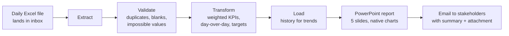
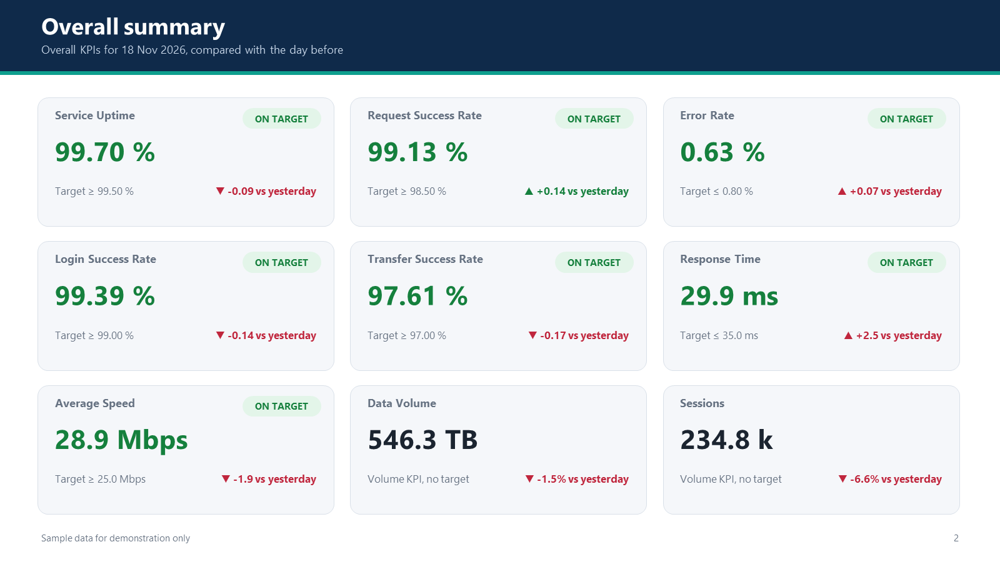
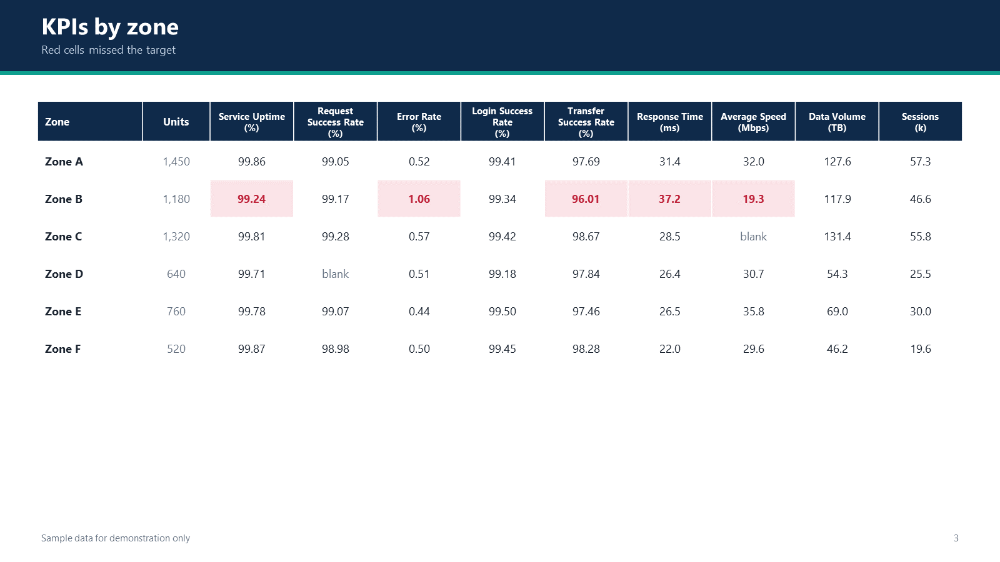
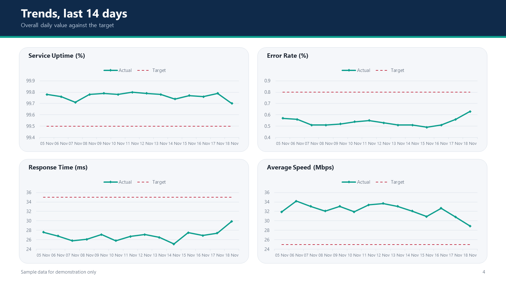
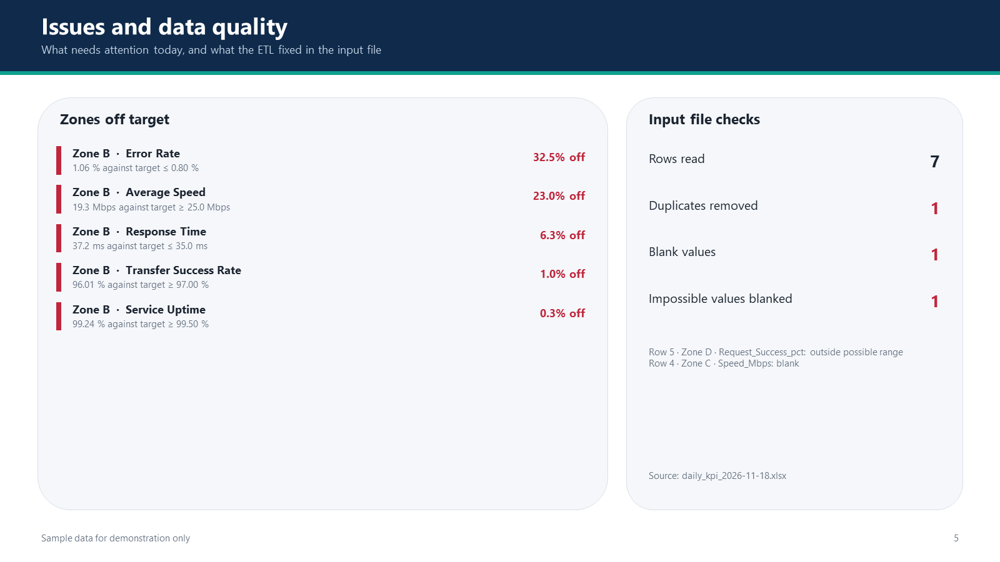

# Daily KPI Report Automation

**Excel file in, finished PowerPoint report out, emailed before the morning meeting. No copy and paste.**

Every morning an operations team receives a KPI export in Excel. Turning it into a management report by hand takes hours: clean the file, check it, calculate the overall totals, compare with yesterday and with the targets, paste everything into slides, then email it.

This project does all of that in about 5 seconds:



> All data in this repository is **generated sample data**. No real company or customer data is included.

## The report

| Overall summary | KPIs by zone |
|---|---|
|  |  |
| **Trends against target** | **Issues and data quality** |
|  |  |

- **Overall summary**: 9 KPI cards with value, target, on/off target and change against yesterday. Green and red follow each KPI's direction, so a fall in the error rate shows as good news.
- **KPIs by zone**: every zone and KPI, with missed targets highlighted.
- **Trends**: last 14 days against the target line. These are real PowerPoint charts, so anyone can edit them.
- **Issues and data quality**: the worst zone misses first, plus what the ETL found and fixed in the input file.

## What the ETL checks

| Check | What happens |
|---|---|
| Missing columns | The run stops with a clear message naming the columns |
| Duplicate rows (same date and zone) | Removed, counted in the report |
| Blank values | Kept as blank, skipped in the totals, listed in the report |
| Impossible values (e.g. a success rate of 187%) | Value blanked, row kept, listed in `data/rejects/` |
| Zone with no units | Row rejected |
| Same day processed twice | History is updated, not duplicated |

Overall KPIs are **weighted by unit count**, so a large zone counts more than a small one. Volume KPIs (data volume, sessions) are summed.

## Quick start

```bash
python -m venv .venv
.venv\Scripts\activate          # macOS/Linux: source .venv/bin/activate
pip install -r requirements.txt

python run_daily.py --sample 30   # create 30 days of sample files and run the pipeline
```

Output:

```
reports/Daily_KPI_Report_<date>.pptx    the report
data/outbox/Daily_KPI_Report_<date>.eml the email (open it in Outlook)
data/rejects/issues_<date>.csv          rows and values the ETL rejected
data/warehouse/kpi_history.csv          clean history used for trends
logs/run_<date>.log                     what happened, step by step
```

Other options:

```bash
python run_daily.py                    # process every file waiting in the inbox, report on the newest
python run_daily.py --date 2026-11-18  # process one specific day
python run_daily.py --no-email         # build the report only
```

## Run it every morning

On Windows, register a Task Scheduler job (runs at 06:30 by default):

```powershell
powershell -ExecutionPolicy Bypass -File scripts\schedule_task.ps1 -Time 06:30
```

On Linux, add a cron line: `30 6 * * * cd /path/to/project && .venv/bin/python run_daily.py`

## Sending real email

By default the pipeline runs in **dry-run** mode and saves the email as an `.eml` file. To send for real, edit `[email]` in `config.toml`:

```toml
mode = "smtp"
smtp_host = "smtp.office365.com"
recipients = ["team@yourcompany.com"]
```

and set the password as an environment variable, never in the file:

```powershell
setx KPI_SMTP_PASSWORD "your-app-password"
```

## Use it with your own data

All KPIs are defined in `config.toml`: the column name, label, unit, target, whether higher or lower is better, and whether to average or sum. Add or remove a `[[kpi]]` block and the validation, totals, slides and email follow automatically. No code changes needed.

## Project layout

```
run_daily.py              entry point: runs the whole pipeline
config.toml               paths, email settings, KPI definitions and targets
kpi_report/
  sample_data.py          sample Excel generator (with planted data errors)
  etl.py                  extract, validate, transform, load
  report.py               PowerPoint builder (python-pptx)
  mailer.py               email builder and sender (SMTP or dry run)
scripts/schedule_task.ps1 Windows Task Scheduler setup
tests/test_pipeline.py    unit tests and one end-to-end test
```

## Tests

```bash
pytest -q
```

## Tech

Python · pandas · openpyxl · python-pptx · smtplib · Windows Task Scheduler · pytest

---

Built by **Sohail Bin Salam Al Break** · [LinkedIn](https://www.linkedin.com/in/sohailbinsalambreaki/)
